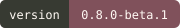
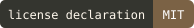
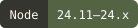
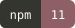

<picture>
  <source media="(prefers-color-scheme: dark)" srcset="docs/assets/readme-beta/exports/hero-dark.png">
  
</picture>

<a id="grow-your-capabilities-with-bowerloom"></a>

# One setup, two engines

<p>
  <a href="https://bowerloom.ai/docs/releases/"></a>
  <a href="LICENSE"></a>
  <a href="package.json"></a>
  <a href="#install-bowerloom"></a>
</p>

Bowerloom lets you define one harness and install it into Claude Code and Codex. A harness is the set of skills, agents, tools, rules, and context that surrounds a coding model. You keep one definition in a `.bowerloom` folder. Bowerloom writes the files of each engine from it.

You can work in the command line or in the desktop app. The desktop app is a main part of Bowerloom 0.8.0-beta.1, next to the command line, and it is a beta.

Every change shows a preview first. Bowerloom writes nothing until you approve the exact plan. It keeps a record of what it wrote, so you can see drift and undo an install. When an engine cannot carry a part of your harness, the preview says so, part by part. An installed copy is never more permissive than its source.

[Main site](https://bowerloom.ai) · [Documentation](https://bowerloom.ai/docs/) · [Report a problem](#report-a-problem)

## Why portability

Many people run more than one coding agent. Each agent keeps its own skills folder, agent files, MCP list, and permission rules. A change in one agent does not reach the other. Bowerloom gives you one source for all of them.

- Adopt what you already have. Bowerloom reads the engine files in a project and builds one harness from them. An adopt changes no engine file.
- Install it everywhere. One install command writes the files for Claude Code and Codex.
- See what each engine can carry. Each part gets one of four results: `exact`, `translated`, `weakened`, or `absent`. If an engine carries a rule more weakly than your harness says, Bowerloom refuses that rule. You accept the line to continue.
- Keep control. Drift shows the files that changed after an install. Remove puts back every file that the install replaced.

## How it works

Run these commands in a project folder. Every command that writes prints a plan and a revision first. To apply the plan, run the same command again with `--approve <revision>`.

```sh
bowerloom harness adopt
bowerloom harness install --engine claude-code --engine codex
bowerloom harness drift
bowerloom harness remove
```

1. `harness adopt` reads the Claude Code and Codex files of the folder and writes only `.bowerloom`.
2. `harness install` writes the engine files from `.bowerloom`. A refused line has a key. Run `harness accept <key>` to approve that line, then install again.
3. `harness drift` lists the files that Bowerloom wrote and that changed since. If a file changed, `harness drift --check` fails.
4. `harness remove` puts back every file that install replaced, and deletes the files that install created.

`bowerloom help harness` lists every flag. No harness command runs an engine or a model.

This beta supports Claude Code and Codex. OpenCode, Pi, and DeepSeek Harness are preview engines. To install into them, set `BOWERLOOM_PREVIEW_ENGINES=1`.

## Current capabilities

<!-- release:support:start -->
Open beta · 0.8.0-beta.1

Setup does not start workers, grant runtime access, or authorize connected actions.

| Capability | Current boundary |
| --- | --- |
| Harness | Adopt the Claude Code and Codex files of a project into one `.bowerloom` definition. Then install it into both engines after a preview. |
| Fidelity | The preview reports each part as exact, translated, weakened, or absent, per engine. A weaker rule needs your approval, line by line. |
| Recovery | Drift lists changed files. Remove puts back what an install replaced. |
| Portable skills | Pin skills from npm or GitHub with skills add. Then install them for Claude Code and Codex with skills sync. |
| Execution | Setup does not start workers, grant runtime access, or authorize connected actions. |

These guides use macOS arm64 and Node 24.11.0. Other host systems are outside this documented installation path.
<!-- release:support:end -->

## Beta limits

- Pinned skills come from public sources only. A store in a private GitHub repository needs `BOWERLOOM_GITHUB_TOKEN`. Only MIT and Apache-2.0 skills install.
- Keep your project out of iCloud Drive folders. Project commands refuse a project in a cloud-synced folder with `PROJECT_IN_CLOUD_FOLDER`.
- The desktop app is a beta. The Builder, the save step, and Save points exist only in the app. The adopt, install, drift, and remove steps work in both.
- Beta.1 supports Claude Code and Codex. OpenCode, Pi, and DeepSeek Harness are preview engines. They install only with `BOWERLOOM_PREVIEW_ENGINES=1`.
- The npm package is not published yet. The install command arrives when the beta publishes.
- Apple did not sign this build. [Open the unsigned app](#open-the-unsigned-app) gives the steps to open it.

## Install Bowerloom

The CLI arrives on npm as `bowerloom`, under the `beta` dist-tag, when the beta publishes. This README shows no install command until then. Bowerloom is open source under the MIT license. It needs Node `>=24.11.0 <25` and npm `11`.

If you have a release file, install it by its full path, such as `npm install -g ~/Downloads/bowerloom-0.8.0-beta.1.tgz`. Then run `bowerloom --version` and `bowerloom --help`.

If npm refuses with a permission error, do not use `sudo`. Set a user prefix for global packages instead. The [install guide](https://bowerloom.ai/docs/start/) shows the steps.

## The desktop app

The desktop app is a beta, and it is a main part of this release. It does the adopt, install, and remove steps on screen, after a preview and an approval. It also has the Builder, which shows a harness as a graph of agents and skills, and the save step, which saves a change to the harness after you review and approve it. Each save keeps a save point. Go back returns the harness to a save point, and Set aside starts a new record of save points. Notes and the ready-made Notes keeper kit let agents read a folder of notes. The [desktop app guide](https://bowerloom.ai/docs/app/) covers each screen.

## Open the unsigned app

The desktop app is open source. Apple did not sign or notarize it. The first time you open it, macOS blocks it and shows a warning. You can read the source in this repository before you open it.

1. Download the app from the GitHub release page of Bowerloom 0.8.0-beta.1. Move `Bowerloom.app` to your Applications folder.
2. Open the app once. macOS shows a warning. Close the warning.
3. Open the Apple menu, then System Settings.
4. Click Privacy & Security, then scroll down to Security.
5. Click Open Anyway next to the message about Bowerloom. The button is available for about an hour after step 2.
6. If macOS asks for your login password, enter it. Then click Open.

After this, the app opens like any other app. If you do not want to allow an unsigned app, use the command line. It covers the adopt, install, drift, and remove steps.

## Report a problem

Bowerloom never sends anything by itself. To report a problem, make a diagnostic bundle and read it. Then open the issue yourself.

```sh
bowerloom report
```

The bundle holds the Bowerloom version, the macOS version, and the Claude Code and Codex versions. It also holds the last error code, recent event lines, and the hash of the last plan. It holds no secrets, no file contents, and no home folder path. The command prints the bundle and a link to a new GitHub issue that holds the bundle. `bowerloom report --json` gives the same bundle to an agent, so your agent can write the issue for you. In the app, choose Help > Report a problem.

Choose the issue form that fits:

- [Bug](https://github.com/sageadvicellc/bowerloom/issues/new?template=bug.yml): Bowerloom did something wrong or stopped with an error.
- [Fidelity gap](https://github.com/sageadvicellc/bowerloom/issues/new?template=fidelity-gap.yml): an installed copy differs from its source, and the preview did not say so.
- [Engine change](https://github.com/sageadvicellc/bowerloom/issues/new?template=engine-change.yml): a new Claude Code or Codex version changed what Bowerloom installs.

Ask questions in [Q&A](https://github.com/sageadvicellc/bowerloom/discussions/categories/q-a). Share ideas in [Ideas](https://github.com/sageadvicellc/bowerloom/discussions/categories/ideas).

## Your usage log

Bowerloom keeps a small event log on your computer. It records which tasks finished, such as an adopt or an install, and error codes. It records no names, no paths, and no file contents. It makes no network calls.

```sh
bowerloom events
bowerloom events summary
```

`bowerloom events` shows the newest events. `bowerloom events summary` shows the counts of the last seven days. To help us, save the summary with `--out <file>` and attach it to an issue. To turn the log off, set `BOWERLOOM_EVENT_LOG=off`. In the app, choose Help > Usage log.

After an install in the app, Bowerloom asks "Did this do what you wanted?" For "Partly" or "No", it then asks what you were trying to do. Your answer stays in the local log.

## Later work

These items are named for later releases, but they are not promises: Windows and Linux, team sync, signing and automatic updates, other knowledge bases, and more engines.

## Contributing


Bring a small, reproducible change that the team can review.

- Describe the problem and the result that you expect.
- Include a focused example or a test with your change.
- Follow the [contributor guide](https://bowerloom.ai/docs/contributors/) for source changes and review.

Keep credentials, customer data, and private references out of public issues and pull requests. Use [GitHub Issues](https://github.com/sageadvicellc/bowerloom/issues) to agree on the scope before a large change.

Made by Sage Advice. [License](LICENSE) · [Source](https://github.com/sageadvicellc/bowerloom).
